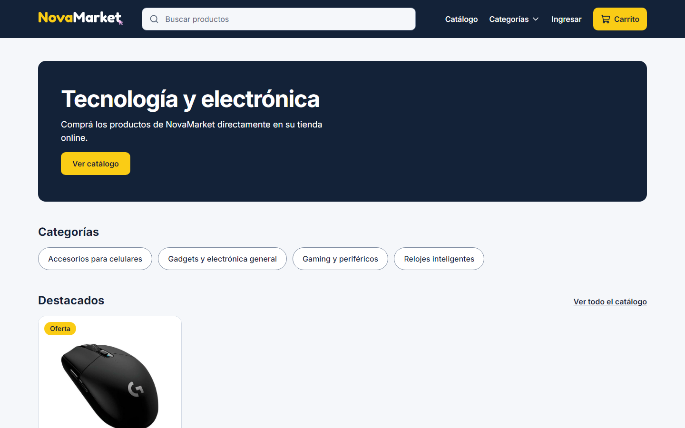
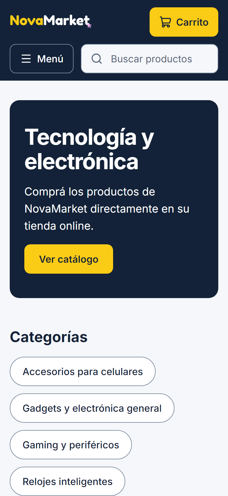
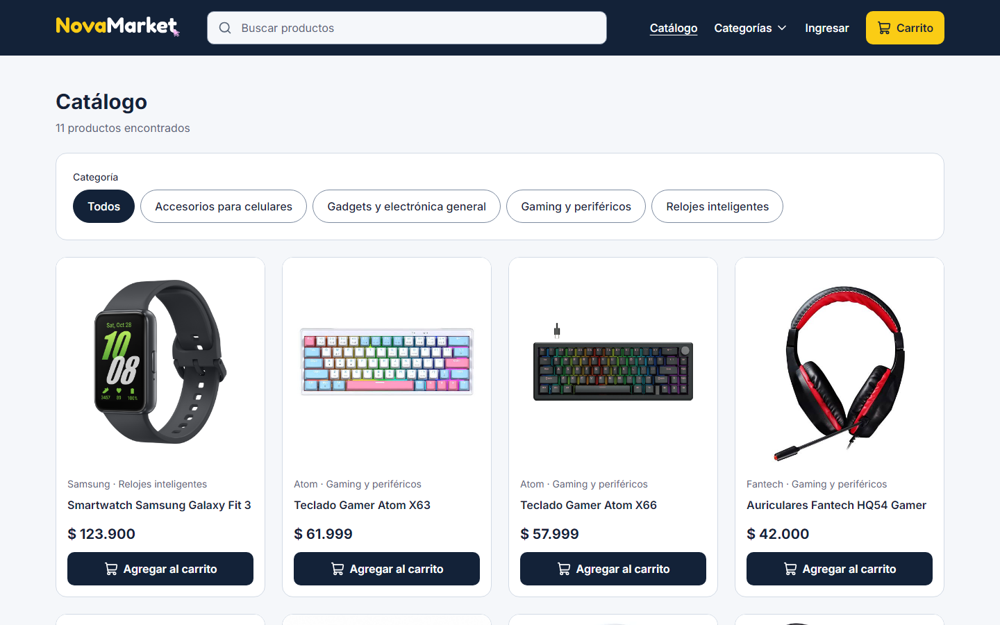
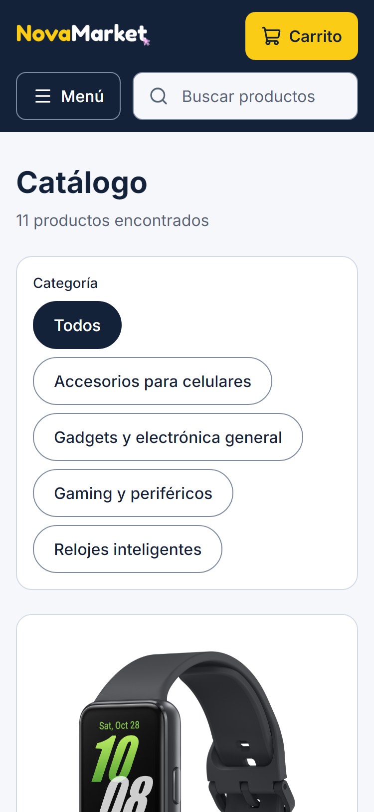
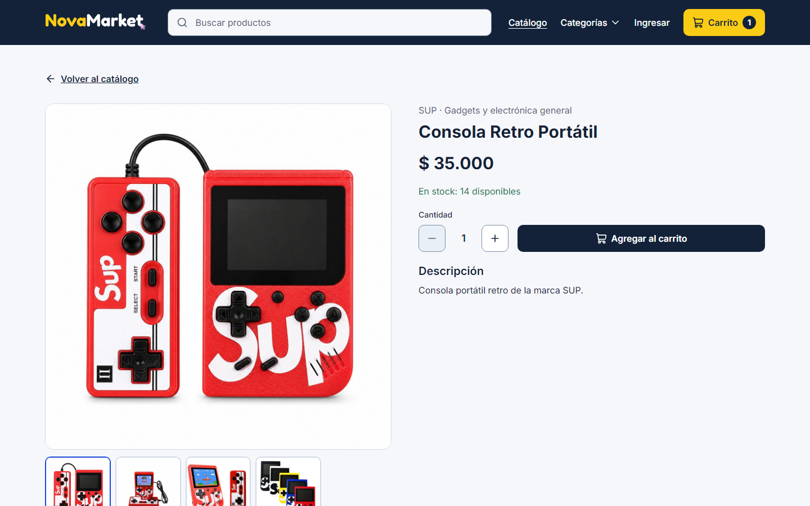
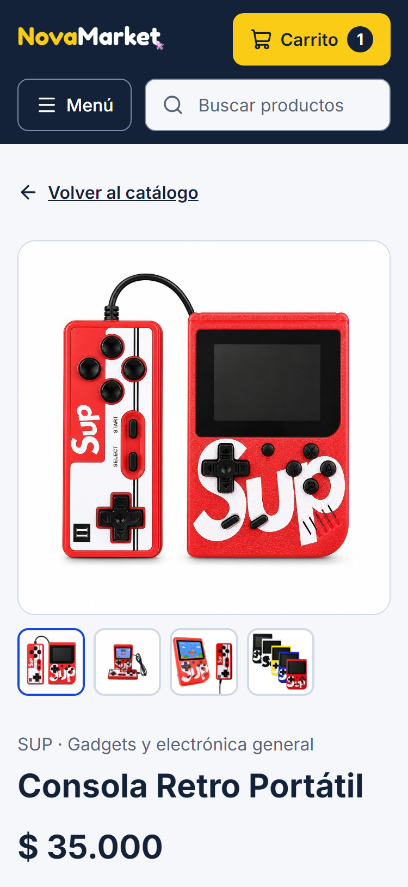
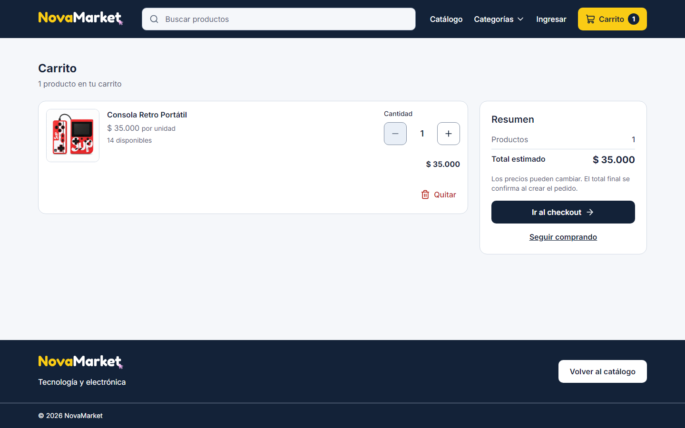
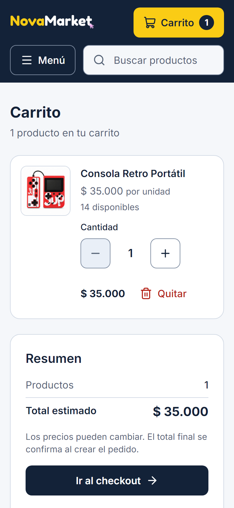

# NovaMarket — Frontend

Frontend del MVP de NovaMarket, el canal de venta online propio de una tienda de tecnología que hoy vende por redes sociales y marketplaces. Cubre el recorrido de compra completo (Home, catálogo con búsqueda y filtro por categoría, detalle de producto, carrito, checkout simulado y confirmación del pedido), el registro y el inicio de sesión, y un panel de administración para gestionar productos y ver pedidos.

- **Web en producción:** https://s2621-novamarket.vercel.app
- **Backend:** carpeta [`/backend`](../backend) de este monorepo (API REST con Node, Express y MongoDB).



## Funcionalidades

- **Home:** banner principal, categorías, productos destacados y ofertas.
- **Catálogo:** grilla de productos con búsqueda desde el `Navbar`, filtro por categoría y paginación; los filtros quedan en la URL.
- **Detalle de producto:** galería de hasta 5 imágenes, precio (con precio de oferta), stock, descripción, especificaciones y selector de cantidad.
- **Carrito:** agregar, cambiar cantidades (sin superar el stock) y quitar productos; se guarda en el navegador.
- **Checkout simulado:** requiere sesión; confirma el pedido contra la API y muestra la confirmación con el número de orden. No hay pasarela de pago real.
- **Registro e inicio de sesión:** validaciones en el formulario, mensajes de error de la API y sesión que se revalida al recargar.
- **Panel de administración (`/admin`):** solo para el rol `ADMIN`. Resumen con indicadores (productos activos e inactivos, stock bajo, pedidos y total vendido), listado de productos con filtro, búsqueda y paginación, alta y edición, baja con confirmación y reactivación, y listado y detalle de pedidos.
- **Responsive y accesible:** diseño mobile-first (375, 768, 1024, 1280 y 1440 px), navegación con teclado y foco visible, estados de carga, error y vacío en todas las pantallas, y mensajes de error pensados para el usuario (sin textos técnicos).

## Stack

| Herramienta      | Versión |
| ---------------- | ------- |
| Node.js          | 20.19+  |
| React            | 18.3    |
| Vite             | 8.3     |
| Tailwind CSS     | 3.4     |
| React Router DOM | 6.30    |
| Axios            | 1.20    |
| lucide-react     | 1.47    |
| ESLint           | 10      |
| Prettier         | 3.9     |

Lenguaje: JavaScript (sin TypeScript). Estado global: Context API. Gestor de paquetes: npm.

## Cómo correrlo localmente

### Requisitos

- Node.js 20.19 o superior (el repo trae `.nvmrc`).
- npm.
- Una API de NovaMarket disponible: el backend de [`/backend`](../backend) corriendo en local o la API publicada (pedí la URL al equipo de Back).

### Instalación

```bash
cd frontend
npm install
cp .env.example .env
```

Completá los valores del `.env` (o de un `.env.local`, que tiene prioridad) y levantá el dev server:

```bash
npm run dev
```

La app queda en `http://localhost:5173`. Usá ese puerto (el que trae Vite por defecto): es el origen que la API acepta por CORS en desarrollo.

### Variables de entorno

| Variable          | Obligatoria | Descripción                                                                                                           |
| ----------------- | ----------- | --------------------------------------------------------------------------------------------------------------------- |
| `VITE_API_URL`    | Sí          | URL base de la API, terminada en `/api`.                                                                              |
| `VITE_ASSETS_URL` | No          | Host de las imágenes con ruta relativa (`/uploads/...`). Si no se define, se usa `VITE_API_URL` sin el sufijo `/api`. |

Vite reemplaza estas variables al compilar: si cambia una, hace falta un build nuevo. `.env` y `.env.local` no se versionan (están en `.gitignore`); el repo solo tiene `.env.example`.

### Scripts

| Comando                | Qué hace                                                              |
| ---------------------- | --------------------------------------------------------------------- |
| `npm run dev`          | Dev server con recarga en caliente.                                   |
| `npm run build`        | Build de producción en `dist/`.                                       |
| `npm run preview`      | Sirve el build de `dist/` en local.                                   |
| `npm run lint`         | ESLint sobre todo el proyecto.                                        |
| `npm run format`       | Formatea el código con Prettier.                                      |
| `npm run format:check` | Verifica el formato sin modificar archivos (lo corren pre-push y CI). |

Antes de cada push, el hook de husky corre `format:check`, `lint` y `build`; CI repite los tres en Node 20 y 22.

## Deploy

La web está publicada en Vercel desde la carpeta `frontend/` (proyecto `s2621-novamarket`, framework Vite, build `npm run build` y salida `dist/`).

- `vercel.json` hace de proxy de la API: `/api/:path*` y `/uploads/:path*` se reenvían al backend del lado del servidor, así que el navegador solo habla con el dominio de la web y no hay pedidos entre orígenes (sin CORS). En Production y Preview, `VITE_API_URL` vale `/api`.
- Las imágenes con URL absoluta (Cloudinary) no pasan por el proxy: el navegador las pide directo.
- Los rewrites del proxy van antes del catch-all, que manda cualquier otra ruta a `index.html`: así los enlaces directos (`/products/:id`, `/checkout`, `/admin`) no dan 404 al abrirlos o recargarlos, y una ruta desconocida muestra `NotFound`.
- `.vercelignore` evita subir `node_modules`, `dist` y los `.env` locales: el build usa las variables cargadas en el proyecto de Vercel.
- El proyecto de Vercel no está conectado al repo: se deploya con la CLI desde `frontend/` (hace falta acceso al proyecto):

```bash
npx vercel login
npx vercel link --project s2621-novamarket
npx vercel deploy --prod
```

Estado de la integración con la API al 17/11/2026:

| Qué                                                      | Estado                                                                                                                |
| -------------------------------------------------------- | --------------------------------------------------------------------------------------------------------------------- |
| CORS                                                     | Resuelto con el proxy de `vercel.json`. Sin errores de CORS en la pestaña Network.                                    |
| `GET /api/categories`, `/api/products` y `/products/:id` | Desplegados. Home, catálogo, filtro por categoría, búsqueda, detalle con galería y carrito verificados en producción. |
| `POST /api/auth/register`, `/login` y `GET /api/auth/me` | Desplegados: responden con las validaciones del contrato (401 sin token).                                             |
| `POST /api/orders` y `GET /api/orders/:id`               | Desplegados: piden sesión (401 sin token). El checkout completo se prueba a mano con una cuenta de cliente.           |

## Calidad y compatibilidad

Auditoría del 17/11/2026 sobre producción, sin sesión y sin crear datos, con Playwright en Chromium, Firefox y WebKit, a 375, 768, 1024, 1280 y 1440 px. Recorrido: Home, catálogo, filtro por categoría, búsqueda, detalle y galería, agregar al carrito, carrito (cambiar cantidad y quitar), entrada al checkout (redirige a `/login`), login, registro, 404 y `/admin` (redirige a `/login`).

- Sin errores ni advertencias en la consola, sin pedidos fallidos y sin errores de CORS.
- Sin scroll horizontal ni elementos fuera de pantalla en ningún ancho.
- Sin textos técnicos en pantalla: los errores de la API se muestran con el mensaje del contrato o con un mensaje genérico.
- Navegación con teclado: se puede comprar con Tab y Enter (agregar al carrito, cambiar cantidades, ir al checkout) y todos los elementos con foco muestran el anillo de foco.
- WebKit/Safari: por defecto, Tab salta los enlaces y solo recorre botones y campos; con Option + Tab (o activando "Resaltar cada elemento con Tab" en Safari) se recorren todos. Es una preferencia del navegador, no de la app.

WebKit de Playwright es el motor de Safari, pero no reemplaza una prueba en Safari real (iPhone o Mac).

## Capturas

Tomadas el 17/11/2026 en producción, en 1440 × 900 (desktop) y 375 × 812 (mobile).

| Pantalla | Desktop                                                                                     | Mobile                                                                                    |
| -------- | ------------------------------------------------------------------------------------------- | ----------------------------------------------------------------------------------------- |
| Home     |         |         |
| Catálogo |  |  |
| Detalle  |    |    |
| Carrito  |      |      |
| Checkout | Pendiente: la captura requiere una sesión de cliente.                                       | Pendiente.                                                                                |

## Estructura de carpetas

```
frontend/
├── docs/screenshots/  # Capturas del README
├── public/            # Archivos estáticos servidos tal cual (favicon)
├── src/
│   ├── assets/        # Logo e imágenes importadas desde el código
│   ├── components/    # Componentes reutilizables, por dominio
│   │   ├── admin/     # Layout, tablas, formulario y tarjetas del panel
│   │   ├── cart/      # Ítem y resumen del carrito
│   │   ├── home/      # Banner de categorías, destacados y ofertas
│   │   ├── layout/    # Layout, Navbar, menú de categorías, logo y footer
│   │   ├── order/     # Detalle de una orden
│   │   ├── product/   # Tarjeta, grilla, galería, precio, filtros y buscador
│   │   └── ui/        # Botones, campos, loader, mensajes, paginación, diálogos
│   ├── context/       # Contextos de sesión y carrito (Context API)
│   ├── hooks/         # useAuth, useCart y hooks de datos
│   ├── pages/         # Una vista por ruta; las del panel en pages/admin/
│   ├── routes/        # AppRouter y guards (ProtectedRoute, AdminRoute)
│   ├── services/      # Instancia de Axios y un servicio por recurso de la API
│   └── utils/         # Funciones puras (formato de precios y fechas, órdenes, formulario)
├── .env.example       # Variables de entorno (sin valores reales)
├── vercel.json        # Proxy de la API y rewrite de la SPA
└── vite.config.js
```

## Arquitectura de componentes

Esta sección define cómo se organiza el frontend: carpetas, rutas, componentes reutilizables, manejo de estado y capa de servicios. Está alineada con el **Contrato API v0.3** publicado por Back y con las decisiones de UX de las reuniones del 24/09 (menú de categorías en el `Navbar`, secciones de destacados y ofertas en la Home, botón directo de WhatsApp, footer con información legal y páginas de soporte) y del 29/09 (banner de categorías en la Home en lugar del carrusel de campañas y Admin enfocado en el CRUD de productos). Es la referencia para implementar las pantallas de UX (Home, Catálogo, Detalle de producto, Carrito, Checkout, Login, Registro, Admin y Not Found) más las que surgen del contrato y de esas decisiones (Mis pedidos, Confirmación de orden y páginas de soporte), cada una en desktop (1440), tablet (768) y mobile (375).

Lo que depende de wireframes que todavía no están dibujados queda marcado como **a validar con UX**. Los puntos que esperaban respuesta de Back (`FE-03` a `FE-07`) quedaron resueltos en el Contrato API v0.3 (§31) y ya están aplicados en esta sección. Ambos se resumen en [Pendientes](#pendientes).

### Carpetas y responsabilidades

Organización interna prevista para la [estructura de carpetas](#estructura-de-carpetas):

```
src/
├── assets/        # Imágenes e íconos estáticos
├── components/    # Componentes reutilizables, agrupados por dominio
│   ├── ui/        # Button, Input, Select, Textarea, FieldMessages, Loader, ErrorMessage, Notice, EmptyState, Badge, Pagination, QuantitySelector, ConfirmDialog
│   ├── layout/    # Layout, Navbar, Logo, CategoryMenu, Footer, WhatsAppButton
│   ├── home/      # CategoryBanner, FeaturedProducts, Offers
│   ├── product/   # ProductCard, ProductGrid, ProductImage, ProductGallery, ProductPrice, SpecificationsTable, SearchBar, CategoryFilter
│   ├── cart/      # CartItem, CartSummary
│   ├── order/     # OrderList, OrderDetail
│   └── admin/     # AdminLayout, StatCard, ProductForm, ProductTable, OrderTable
├── context/       # AuthContext.js, AuthProvider.jsx, CartContext.js, CartProvider.jsx
├── hooks/         # useAuth, useCart, useProducts, useProduct, useCategories, useOrder, useOrders
├── pages/         # Una página por ruta (se agregan MyOrders, OrderConfirmation, Contact, About y ReturnPolicy); las de Admin van en pages/admin/
├── routes/        # AppRouter, ProtectedRoute, AdminRoute
├── services/      # api.js, authService, productService, categoryService, orderService
└── utils/         # format.js (formatPrice, formatDate y formatShortDate), order.js (estado, id corto y comprador de una orden) y productForm.js (reglas del formulario de producto)
```

| Carpeta       | Qué va                                                                                                                    | Regla                                                                                                                               |
| ------------- | ------------------------------------------------------------------------------------------------------------------------- | ----------------------------------------------------------------------------------------------------------------------------------- |
| `components/` | Piezas de UI reutilizables y bloques grandes que conviene aislar de la página (como el formulario y las tablas de Admin). | No llaman a la API: reciben los datos por props. Solo leen contexto (`useAuth`, `useCart`) cuando necesitan la sesión o el carrito. |
| `pages/`      | Una vista completa por ruta.                                                                                              | Piden los datos (a través de hooks), manejan los filtros y estados de la vista y arman la pantalla con los componentes.             |
| `services/`   | La instancia de Axios y un módulo por recurso de la API.                                                                  | Único lugar que conoce Axios y las URLs. Cada función devuelve `response.data`.                                                     |
| `context/`    | Estado global con Context API.                                                                                            | Solo sesión (`AuthContext`) y carrito (`CartContext`).                                                                              |
| `hooks/`      | Custom hooks: acceso a los contextos y pedido de datos.                                                                   | Los hooks de datos devuelven `{ data, loading, error, refetch }`.                                                                   |
| `routes/`     | Definición de rutas y guards de acceso.                                                                                   | Solo navegación y control de acceso.                                                                                                |
| `utils/`      | Funciones puras sin React ni API (formato de precios y fechas).                                                           | No importan componentes, contextos ni servicios.                                                                                    |
| `assets/`     | Archivos estáticos que se importan desde el código.                                                                       | —                                                                                                                                   |

Excepción a la regla de `components/`: `CategoryMenu` (el desplegable de categorías del `Navbar`) usa `useCategories` directamente, porque el `Navbar` se renderiza en todas las páginas y ninguna de ellas es dueña de ese dato.

Convenciones:

- Un componente por archivo, en PascalCase y con `export default`, igual que las páginas actuales (`components/ui/Button.jsx`).
- Hooks en camelCase con prefijo `use` (`hooks/useProducts.js`) y servicios con sufijo `Service` (`services/productService.js`).
- Cada contexto se reparte en tres archivos: el objeto de contexto (`context/AuthContext.js`), el Provider (`context/AuthProvider.jsx`) y el hook de acceso (`hooks/useAuth.js`). La regla `react-refresh/only-export-components` de ESLint da error si un `.jsx` exporta el Provider junto con el contexto o con el hook.
- Estilos con Tailwind, mobile-first: la base es mobile (375), `md:` es tablet (768) y `lg:` es desktop (diseños en 1440). Los íconos salen de `lucide-react`.
- Las subcarpetas y los archivos que se nombran en esta sección se crean a medida que se implementa cada pieza; mientras tanto `components/`, `context/` y `hooks/` se mantienen con `.gitkeep`.

### Páginas y rutas

`routes/AppRouter.jsx` ya declara las rutas de las pantallas de UX con páginas placeholder. Todas se renderizan dentro de `Layout` (`Navbar` + contenido + `Footer` + `WhatsAppButton`) y las que requieren sesión se anidan dentro de los guards, que funcionan como rutas de layout con `<Outlet />`:

```jsx
<Route element={<Layout />}>
  <Route path="/" element={<Home />} />
  {/* ...resto de las rutas públicas, incluidas las de soporte */}
  <Route element={<ProtectedRoute />}>
    <Route path="/checkout" element={<Checkout />} />
    <Route path="/orders" element={<MyOrders />} />
    <Route path="/orders/:id" element={<OrderConfirmation />} />
  </Route>
  <Route element={<AdminRoute />}>
    <Route path="/admin" element={<AdminLayout />}>
      <Route index element={<AdminDashboard />} />
      <Route path="products" element={<AdminProducts />} />
      <Route path="products/new" element={<AdminProductCreate />} />
      <Route path="products/:id/edit" element={<AdminProductEdit />} />
      <Route path="orders" element={<AdminOrders />} />
      <Route path="orders/:id" element={<AdminOrderDetail />} />
    </Route>
  </Route>
  <Route path="*" element={<NotFound />} />
</Route>
```

| Ruta                       | Página               | Pantalla UX                                    | Acceso                                  | Contenido                                                                                                                                                                                                                                                                                                                         |
| -------------------------- | -------------------- | ---------------------------------------------- | --------------------------------------- | --------------------------------------------------------------------------------------------------------------------------------------------------------------------------------------------------------------------------------------------------------------------------------------------------------------------------------- |
| `/`                        | `Home`               | Home                                           | Público                                 | `CategoryBanner` (categorías de `GET /api/categories`; cada una enlaza a `/products?category=<id>`), `FeaturedProducts` (`featured=true`) y `Offers` (`offer=true`). **A validar con UX.**                                                                                                                                        |
| `/products`                | `Products`           | Catálogo                                       | Público                                 | `SearchBar`, `CategoryFilter`, `ProductGrid` y `Pagination`. Acepta `?category=<id>` desde el menú del `Navbar` y el banner de la Home, y `?offer=true` desde la sección o el menú de ofertas.                                                                                                                                    |
| `/products/:id`            | `ProductDetail`      | Detalle de producto                            | Público                                 | `ProductGallery` (hasta 5 imágenes), nombre, marca, categoría, `ProductPrice`, descripción, `SpecificationsTable`, `QuantitySelector` y botón "Agregar al carrito".                                                                                                                                                               |
| `/cart`                    | `Cart`               | Carrito                                        | Público                                 | Un `CartItem` por producto y `CartSummary`; `EmptyState` si el carrito está vacío.                                                                                                                                                                                                                                                |
| `/checkout`                | `Checkout`           | Checkout                                       | Autenticado                             | Ítems en modo lectura, formulario de envío (nombre y dirección, validados solo en el cliente), `CartSummary` y botón "Confirmar compra" (`POST /api/orders`). Con el carrito vacío redirige a `/products`. Con rol `ADMIN` se muestra un aviso en lugar del botón, porque el contrato permite crear órdenes solo a `CLIENT`.      |
| `/orders`                  | `MyOrders`           | Sin wireframe                                  | Autenticado                             | "Mis pedidos": las órdenes del usuario (`GET /api/orders`) en `OrderList`; cada una lleva a `/orders/:id`. **A validar con UX.**                                                                                                                                                                                                  |
| `/orders/:id`              | `OrderConfirmation`  | Sin wireframe                                  | Autenticado (dueño de la orden o admin) | Detalle de la orden (`GET /api/orders/:id`) en `OrderDetail`: número, estado, ítems, total calculado por el Back y fecha. Se llega después de comprar y desde "Mis pedidos". **A validar con UX.**                                                                                                                                |
| `/login`                   | `Login`              | Login                                          | Público                                 | Formulario de ingreso.                                                                                                                                                                                                                                                                                                            |
| `/register`                | `Register`           | Registro                                       | Público                                 | Formulario de registro (`name`, `lastName`, `email`, `password`); al terminar redirige a `/login`.                                                                                                                                                                                                                                |
| `/admin`                   | `AdminDashboard`     | Sin wireframe (paleta y componentes del sitio) | Admin                                   | Resumen: tarjetas con total de productos, activos, inactivos, stock bajo (activos con 5 unidades o menos), cantidad de pedidos y total vendido; lista corta de productos con stock bajo y los 5 últimos pedidos. Todo se calcula en Front con `GET /api/products?active=all` (todas las páginas, `limit=50`) y `GET /api/orders`. |
| `/admin/products`          | `AdminProducts`      | Sin wireframe                                  | Admin                                   | `ProductTable` con filtro Activos / Inactivos / Todos (`?status=`), búsqueda (`?search=`) y `Pagination` (`?page=`), todo en la URL. Acciones: Editar, Dar de baja (con `ConfirmDialog`) y Reactivar.                                                                                                                             |
| `/admin/products/new`      | `AdminProductCreate` | Sin wireframe                                  | Admin                                   | `ProductForm` vacío; `POST /api/products`.                                                                                                                                                                                                                                                                                        |
| `/admin/products/:id/edit` | `AdminProductEdit`   | Sin wireframe                                  | Admin                                   | `ProductForm` con el producto; `PUT /api/products/:id` con el objeto completo.                                                                                                                                                                                                                                                    |
| `/admin/orders`            | `AdminOrders`        | Sin wireframe                                  | Admin                                   | `OrderTable` con todas las órdenes de `GET /api/orders`, de la más nueva a la más vieja.                                                                                                                                                                                                                                          |
| `/admin/orders/:id`        | `AdminOrderDetail`   | Sin wireframe                                  | Admin                                   | `OrderDetail` de `GET /api/orders/:id` (el admin puede leer cualquiera).                                                                                                                                                                                                                                                          |
| `/contact`                 | `Contact`            | Contacto (pendiente)                           | Público                                 | Página de soporte placeholder. Sin formulario: el contacto es el `WhatsAppButton`. **A validar con UX.**                                                                                                                                                                                                                          |
| `/about`                   | `About`              | Quiénes somos (pendiente)                      | Público                                 | Página de soporte placeholder. **A validar con UX.**                                                                                                                                                                                                                                                                              |
| `/returns`                 | `ReturnPolicy`       | Política de devolución (pendiente)             | Público                                 | Página de soporte placeholder; se enlaza desde la información legal del `Footer`. **A validar con UX.**                                                                                                                                                                                                                           |
| `*`                        | `NotFound`           | Not Found                                      | Público                                 | Aviso de página inexistente y enlace al inicio.                                                                                                                                                                                                                                                                                   |

Comportamiento de los guards:

- `ProtectedRoute`: sin sesión, redirige a `/login` y guarda la ruta de origen para volver a ella después de ingresar (por ejemplo, `/checkout`).
- `AdminRoute`: exige sesión (sin sesión, redirige a `/login` igual que `ProtectedRoute`) y rol `ADMIN`; un usuario con rol `CLIENT` vuelve a `/`.
- Mientras se revalida la sesión al recargar (`GET /api/auth/me`), ambos muestran `Loader` en lugar de redirigir, para no enviar al login a alguien con una sesión válida.

### Componentes reutilizables

Los estados de carga, error y vacío se resuelven siempre con `Loader`, `ErrorMessage` y `EmptyState`, para que se vean igual en todas las pantallas. En la tabla, "—" indica que no aplica; en la última columna significa que el componente no maneja estado propio.

| Componente            | Carpeta              | Props principales                                                                                             | Estados (loading / error / vacío)                                                                                                                                                                                                                             | Estado local / global                                                   |
| --------------------- | -------------------- | ------------------------------------------------------------------------------------------------------------- | ------------------------------------------------------------------------------------------------------------------------------------------------------------------------------------------------------------------------------------------------------------- | ----------------------------------------------------------------------- |
| `Button`              | `components/ui`      | `children`, `variant` (`primary`, `secondary`, `danger`), `type`, `disabled`, `loading`, `onClick`            | loading: spinner y botón deshabilitado                                                                                                                                                                                                                        | —                                                                       |
| `Input`               | `components/ui`      | `label`, `name`, `type`, `value`, `onChange`, `error`, `required`, `placeholder`, `hint`                      | error: mensaje debajo del campo; `hint` muestra una ayuda (por ejemplo, la política de contraseña)                                                                                                                                                            | — (controlado por el formulario)                                        |
| `Loader`              | `components/ui`      | `label` (texto accesible), `size`                                                                             | Representa el estado loading                                                                                                                                                                                                                                  | —                                                                       |
| `ErrorMessage`        | `components/ui`      | `message`, `onRetry` (opcional), `action` (opcional: enlace o botón)                                          | Representa el estado error; muestra "Reintentar" si recibe `onRetry`                                                                                                                                                                                          | —                                                                       |
| `EmptyState`          | `components/ui`      | `title`, `description`, `action` (opcional)                                                                   | Representa el estado vacío                                                                                                                                                                                                                                    | —                                                                       |
| `Badge`               | `components/ui`      | `children`, `variant` (`offer`, `featured`, `status`, `success`, `neutral`)                                   | —                                                                                                                                                                                                                                                             | —                                                                       |
| `Pagination`          | `components/ui`      | `page`, `totalPages`, `total` (los tres de `pagination`), `onPageChange`                                      | No se muestra si hay una sola página; "Anterior" y "Siguiente" se deshabilitan en los extremos; muestra el `total` de resultados                                                                                                                              | — (la página actual vive en la vista)                                   |
| `QuantitySelector`    | `components/ui`      | `value`, `min`, `max` (el `stock`), `onChange`, `disabled`                                                    | Botones deshabilitados en los límites                                                                                                                                                                                                                         | —                                                                       |
| `Layout`              | `components/layout`  | — (renderiza `Navbar`, `<Outlet />`, `Footer` y `WhatsAppButton`)                                             | —                                                                                                                                                                                                                                                             | —                                                                       |
| `Navbar`              | `components/layout`  | —                                                                                                             | Sin sesión, con sesión (nombre del usuario, "Mis pedidos" y "Salir") y admin (enlace a Admin); contador del carrito                                                                                                                                           | Global: `useAuth`, `useCart`. Local: menú mobile abierto o cerrado      |
| `CategoryMenu`        | `components/layout`  | —                                                                                                             | loading (`Loader` chico), error (aviso con "Reintentar") y vacío ("No hay categorías disponibles") dentro del menú, sin afectar al resto del `Navbar`. Cada opción navega a `/products?category=<id>`                                                         | Global: `useCategories`. Local: desplegable abierto o cerrado           |
| `Footer`              | `components/layout`  | —                                                                                                             | —                                                                                                                                                                                                                                                             | —                                                                       |
| `WhatsAppButton`      | `components/layout`  | `phone`, `message` (texto inicial opcional)                                                                   | —                                                                                                                                                                                                                                                             | —                                                                       |
| `CategoryBanner`      | `components/home`    | `categories` (`{ id, name }`), `loading`, `error`                                                             | loading (`Loader` chico); error o vacío: el banner no se muestra y el resto de la Home sigue usable. Cada categoría enlaza a `/products?category=<id>`                                                                                                        | —                                                                       |
| `FeaturedProducts`    | `components/home`    | `products`, `loading`, `error`, `onRetry`                                                                     | loading (`Loader`), error (`ErrorMessage`), vacío (la sección no se muestra)                                                                                                                                                                                  | —                                                                       |
| `Offers`              | `components/home`    | `products`, `loading`, `error`, `onRetry`                                                                     | loading (`Loader`), error (`ErrorMessage`), vacío (la sección no se muestra)                                                                                                                                                                                  | —                                                                       |
| `ProductCard`         | `components/product` | `product` (`id`, `name`, `brand`, `regularPrice`, `salePrice`, `images`, `stock`, `featured`)                 | Sin stock: etiqueta "Sin stock" y botón deshabilitado. Con todo el stock ya en el carrito, el botón también se deshabilita. Al agregar, el botón muestra "Agregado" unos segundos. En oferta: `Badge` "Oferta" y `ProductPrice` con el precio regular tachado | Global: `addItem` de `useCart`                                          |
| `ProductGrid`         | `components/product` | `products`, `loading`, `error`, `onRetry`, `emptyMessage`                                                     | loading (`Loader`), error (`ErrorMessage`), vacío (`EmptyState`)                                                                                                                                                                                              | —                                                                       |
| `ProductImage`        | `components/product` | `src` (`images[0]`), `alt`, `className`                                                                       | Placeholder si `images` está vacío o la imagen no carga                                                                                                                                                                                                       | Local: error de carga de la imagen                                      |
| `ProductGallery`      | `components/product` | `images` (hasta 5), `alt`                                                                                     | Vacío: un `ProductImage` con placeholder; una sola imagen: sin miniaturas                                                                                                                                                                                     | Local: imagen seleccionada                                              |
| `ProductPrice`        | `components/product` | `regularPrice`, `salePrice`, `size`                                                                           | —                                                                                                                                                                                                                                                             | —                                                                       |
| `SpecificationsTable` | `components/product` | `specifications` (objeto clave-valor)                                                                         | Vacío: no se renderiza                                                                                                                                                                                                                                        | —                                                                       |
| `SearchBar`           | `components/product` | `value`, `onSearch`, `placeholder`                                                                            | —                                                                                                                                                                                                                                                             | Local: texto en edición; emite `onSearch` al enviar                     |
| `CategoryFilter`      | `components/product` | `categories` (`{ id, name }`), `value`, `onChange`, `loading`, `error`                                        | loading (deshabilitado), error (aviso breve; el catálogo sigue usable)                                                                                                                                                                                        | —                                                                       |
| `CartItem`            | `components/cart`    | `item` (`productId`, `name`, `image`, `price`, `stock`, `quantity`), `readOnly`                               | `readOnly`: fila compacta para el checkout, sin controles                                                                                                                                                                                                     | Global: `updateQuantity` y `removeItem` de `useCart`                    |
| `CartSummary`         | `components/cart`    | `title`, `children` (la acción de cada página: "Ir al checkout" o "Confirmar compra")                         | Aviso de que el total final se confirma al crear el pedido                                                                                                                                                                                                    | Global: `totalItems` y `totalAmount` de `useCart`                       |
| `OrderList`           | `components/order`   | `orders`, `loading`, `error`, `onRetry`                                                                       | loading, error y vacío ("todavía no hiciste pedidos", con enlace al catálogo)                                                                                                                                                                                 | —                                                                       |
| `OrderDetail`         | `components/order`   | `order` (`id`, `status`, `items`, `total`, `createdAt`)                                                       | —                                                                                                                                                                                                                                                             | —                                                                       |
| `AdminLayout`         | `components/admin`   | — (ruta de layout con `<Outlet />`)                                                                           | Navegación Resumen / Productos / Pedidos con la sección actual marcada (`aria-current`)                                                                                                                                                                       | —                                                                       |
| `StatCard`            | `components/admin`   | `label`, `value`, `hint`, `Icon`, `tone` (`default`, `warning`)                                               | —                                                                                                                                                                                                                                                             | —                                                                       |
| `ProductForm`         | `components/admin`   | `product` (`null` para alta), `categories` (resultado de `useCategories`), `onSubmit(payload)`, `submitLabel` | loading (envío), error general (`ErrorMessage`) y errores por campo, del cliente o de `fields` de la API                                                                                                                                                      | Local: valores, filas de imágenes y de especificaciones, errores y foco |
| `ProductTable`        | `components/admin`   | `products`, `busyId`, `onDeactivate`, `onReactivate`                                                          | Tabla desde `lg`, tarjetas debajo; Reactivar muestra loading en la fila                                                                                                                                                                                       | —                                                                       |
| `OrderTable`          | `components/admin`   | `orders`                                                                                                      | Tabla desde `md`, tarjetas debajo; la columna Cliente solo aparece si la API manda datos del comprador                                                                                                                                                        | —                                                                       |
| `ProtectedRoute`      | `routes`             | — (ruta de layout con `<Outlet />`)                                                                           | loading: `Loader` mientras se revalida la sesión                                                                                                                                                                                                              | Global: `useAuth`                                                       |
| `AdminRoute`          | `routes`             | — (ruta de layout con `<Outlet />`)                                                                           | loading: `Loader` mientras se revalida la sesión                                                                                                                                                                                                              | Global: `useAuth`                                                       |
| `ConfirmDialog`       | `components/ui`      | `open`, `title`, `description`, `confirmLabel`, `onConfirm`, `onCancel`, `loading`, `error`                   | loading (confirmando, no se cierra con Escape) y error dentro del diálogo                                                                                                                                                                                     | —                                                                       |

Detalle de producto y precios:

- `ProductPrice` concentra la regla de precios del contrato: si `salePrice` no es `null`, muestra `salePrice` como precio vigente y `regularPrice` tachado; si es `null`, muestra solo `regularPrice`. Lo usan `ProductCard`, `ProductDetail` y `CartItem`, así el precio se ve igual en toda la app.
- `images` trae hasta 5 valores y `images[0]` es la imagen principal. Cada valor puede ser una URL absoluta de Cloudinary (`https://res.cloudinary.com/...`) o, en productos anteriores, una ruta relativa (`/uploads/products/x.webp`).
- `getImageUrl(path)` en `services/` devuelve las URL absolutas (`http://` o `https://`) sin cambios. A las rutas relativas les antepone la `VITE_API_URL` sin el sufijo `/api`, porque Back sirve `/uploads` como archivos estáticos en su host, fuera de `/api` (`FE-04`, Contrato v0.3 §31): en local, `http://localhost:3000/uploads/products/x.webp`. Sin valor devuelve `null`.
- `ProductImage` es el único que renderiza imágenes de producto: lo usan `ProductCard`, `ProductGallery` y `CartItem` (también en el resumen de `Checkout`). Muestra el placeholder (ícono de `lucide-react`) cuando no hay imagen o cuando no carga (`onError`). El placeholder no es una ``, así que no puede volver a fallar ni generar un bucle. `OrderDetail` no muestra imágenes: los ítems de la orden no traen `image` en el contrato.
- `ProductGallery` muestra la imagen seleccionada en grande y las demás como miniaturas (hasta 5, el máximo del contrato). Su diseño en 1440, 768 y 375 queda a validar con UX.
- `SpecificationsTable` recorre `specifications` como pares clave-valor. El contrato lo define como un objeto flexible, así que el componente no asume claves fijas.

Detalle de Home y layout (decisiones de UX del 24/09 y del 29/09, wireframes pendientes):

- `CategoryBanner` reemplaza al carrusel de campañas (UX, 29/09, por simplicidad). Muestra las categorías que `Home` pide con `useCategories()` (`GET /api/categories`) y cada una enlaza a `/products?category=<id>` (`FE-03`). Como las categorías salen de la API, el front no mantiene slides ni imágenes de campañas.
- `FeaturedProducts` y `Offers` reciben los productos que `Home` pide con `useProducts({ featured: true, limit })` y `useProducts({ offer: true, limit })`; el `limit` (dentro del máximo de 50) lo define UX. Cada sección enlaza al catálogo filtrado (`/products?offer=true`); si además va un menú "Ofertas" en el `Navbar`, apunta a la misma URL.
- `CategoryMenu` es el desplegable de categorías del `Navbar`: navega a `/products?category=<id>`, porque el filtro recibe el `id` de la categoría, no el `name` ni un `slug` (`FE-03`). Muestra el `name` y marca con `aria-current` la categoría que está viendo el catálogo. En desktop es un botón "Categorías" con `aria-expanded` que abre un panel: la flecha abajo abre el panel y pasa el foco a la primera categoría, las flechas, `Home` y `End` recorren las opciones, y `Escape`, un clic afuera o salir con `Tab` lo cierran. En mobile las categorías se listan dentro del menú colapsable.
- `WhatsAppButton` es un enlace `https://wa.me/<número>` que abre en una pestaña nueva; reemplaza al formulario de contacto. El número se configura por variable de entorno (`VITE_WHATSAPP_NUMBER`, que se suma a [Variables de entorno](#variables-de-entorno) cuando se implemente).
- `Footer` tiene tres bloques: enlaces de navegación y soporte (Contacto, Quiénes somos, Política de devolución), la información legal obligatoria sobre derechos del consumidor (el texto lo define el equipo) y el crédito de desarrollo del equipo.

Detalle de Admin (panel de administración; no hay diseño específico, así que usa la paleta, los tokens y los componentes del sitio):

- Todas las rutas `/admin/*` están dentro de `AdminRoute` (sin sesión redirige a `/login`; con rol distinto de `ADMIN`, a `/`) y comparten `AdminLayout`, que se renderiza dentro del `Layout` del sitio.
- **Resumen (`/admin`)**: no hay endpoint de estadísticas, así que las métricas se calculan en Front. Productos y pedidos se piden por separado: si uno falla, el otro bloque se sigue mostrando y el que falló ofrece "Reintentar".
- **Productos (`/admin/products`)**: `GET /api/products` con `active` = `true`, `false` o `all` según el filtro (`FE-06`) y `limit=10`. "Dar de baja" abre un `ConfirmDialog` (un `<dialog>` nativo con `showModal()`: atrapa el foco, cierra con Escape y devuelve el foco al botón) y hace `DELETE /api/products/:id`. "Reactivar" es un `PUT` completo con `active: true`. Las altas, ediciones, bajas y reactivaciones muestran un aviso de éxito (`Notice`) o de error en la página.
- **Formulario (`ProductForm`)**: nombre, marca, descripción, categoría (`useCategories`; se envía el `id`), precio regular, precio de oferta opcional (vacío se envía como `null`), stock, hasta 5 URL de imagen con vista previa (filas que se agregan y quitan; la primera es la principal), especificaciones como filas clave-valor que se convierten en un objeto plano, y los interruptores Activo y Destacado. Valida en el cliente con las mismas reglas que el Back (`utils/productForm.js`), envía los números como números y muestra junto a cada campo los errores de `fields` de un `VALIDATION_ERROR`. Al fallar la validación, el foco va al primer campo con error.
- **Imágenes por URL**: el Back no tiene subida de archivos; `images` es una lista de URL (por ejemplo, de Cloudinary). Se aceptan URL `http(s)` y las rutas relativas de productos anteriores (`/uploads/...`).
- **Edición**: `GET /api/products/:id` no devuelve inactivos, ni siquiera para `ADMIN`. Por eso el listado pasa el producto por el `state` de la navegación; si no está (recarga o enlace directo), `AdminProductEdit` recorre `GET /api/products?active=all` y lo busca por `id` (`productService.findProductForAdmin`).
- **Pedidos (`/admin/orders`)**: `GET /api/orders` devuelve todas las órdenes sin paginar; se ordenan por `createdAt` descendente y muestran id corto, fecha, unidades, total, estado y "Ver detalle" (`/admin/orders/:id`, que reutiliza `OrderDetail`). El contrato todavía no trae datos del comprador: si el Back los agrega (`user`, `customer` o `buyer` con `name`/`email`), aparece la columna Cliente; si no, se omite.

### Estado global y local

Criterio: un dato va a contexto solo si lo usan varias pantallas no relacionadas y tiene que sobrevivir a la navegación. En este MVP eso es la sesión y el carrito; todo lo demás es estado local.

#### `AuthContext`

- **Guarda:** `user` (`id`, `name`, `lastName`, `email` y `role`, que es `CLIENT` o `ADMIN`), `token` y `loading` mientras se revalida la sesión. El token se persiste en `localStorage` con la clave `token` (`TOKEN_STORAGE_KEY`, exportada por `api.js`) para sobrevivir a la recarga, pero no se expone a los componentes: lo usa el interceptor de `api.js`. `loading` arranca en `true` solo si hay un token guardado; sin token no hay nada que revalidar.
- **Expone:** `user`, `isAuthenticated` (hay token y `user`), `isAdmin` (`user.role === 'ADMIN'`), `loading`, `login(credentials)`, `logout()` y `register(data)`.
- **Al iniciar la app:** si hay token, llama a `GET /api/auth/me`. Si responde OK carga `user`; si responde 401 (`INVALID_TOKEN` o `TOKEN_EXPIRED`) limpia la sesión sin redirigir: quien estaba en una página pública sigue ahí, y si la ruta exige sesión el guard lo manda a `/login`. Si falla por otro motivo (API caída o sin conexión), conserva el token pero queda sin `user` hasta la próxima recarga. Siempre termina con `loading` en `false`.
- **Login:** `login(credentials)` llama a `authService.login`, que responde `{ token, user }`, guarda los dos y devuelve `user`. Los errores llegan ya normalizados por `getApiError` (por ejemplo, `INVALID_CREDENTIALS`). El JWT dura 8 horas y no hay refresh: cuando vence, la primera llamada protegida responde 401 `TOKEN_EXPIRED`, el interceptor limpia la sesión y el usuario vuelve a `/login` con `state` `{ reason: 'session-expired', from }`, donde `from` es la ruta en la que estaba.
- **Registro:** `register(data)` llama a `authService.register` con `{ name, lastName, email, password }` y devuelve el `user` creado sin iniciar sesión, porque la API responde 201 `{ message, user }` sin token. `Register` redirige después a `/login`.
- **Logout:** `logout()` borra el token de `localStorage`, limpia el estado, vacía el carrito y navega a `/`.
- **Carrito al cerrar la sesión:** solo el logout manual ("Cerrar sesión") llama a `clearCart()`, porque el carrito vive en el navegador y si no la próxima cuenta que ingrese en el mismo dispositivo vería los productos de la anterior. Un 401 durante la sesión o un token rechazado al iniciar la app limpian la sesión pero conservan el carrito, para que quien vuelve a ingresar (por ejemplo, en pleno checkout) no lo pierda. El login no lo vacía: lo que un invitado agregó antes de ingresar se conserva.

#### `CartContext`

- **Guarda:** `items`, cada uno con `productId`, `name`, `image` (`images[0]`), `price` (el precio unitario que se mostró al agregarlo: `salePrice` si no es `null`; si no, `regularPrice`), `stock` y `quantity` (lo necesario para mostrar el carrito sin volver a pedir los productos). El carrito vive solo en el front: se persiste en `localStorage` y el Back no lo guarda.
- **Expone:** `items`, `totalItems` (contador del `Navbar`), `totalAmount` (estimado), `addItem(product, quantity)` (devuelve cuántas unidades agregó: 0 si no hay stock o el carrito ya tiene todo el disponible), `updateQuantity(productId, quantity)`, `removeItem(productId)` y `clearCart()`.
- `totalItems` y `totalAmount` se calculan con `useMemo` a partir de `items`; no se guardan por separado. `totalAmount` usa el `price` de cada ítem, pero es solo orientativo: el Back es la fuente de verdad de precios, stock y totales.
- `addItem` rechaza productos con `stock` 0 y ninguna cantidad puede superar el `stock` del producto ni bajar de 1. Agregar un producto que ya está suma la cantidad y actualiza nombre, imagen, precio y stock con los datos recientes.
- Se persiste en `localStorage` con la clave `cart`. Al cargar, se descartan los ítems con forma inválida o sin stock y se ajustan las cantidades al stock guardado.

`CartProvider` y `AuthProvider` envuelven las rutas dentro de `BrowserRouter`, porque `AuthProvider` necesita navegar a `/login` cuando se limpia la sesión. `CartProvider` va afuera porque `AuthProvider` usa `useCart` para vaciar el carrito en el logout manual.

#### Estado local

| Qué                                                                                                                    | Dónde vive                                                                                          | Por qué no es global                                                            |
| ---------------------------------------------------------------------------------------------------------------------- | --------------------------------------------------------------------------------------------------- | ------------------------------------------------------------------------------- |
| Formularios (login, registro, producto en Admin)                                                                       | El componente del formulario (`useState`)                                                           | Solo importa mientras se completa y se descarta al enviar o salir.              |
| Búsqueda, categoría, oferta y página del catálogo                                                                      | La página `Products`, reflejada en la URL (`?search=&category=&offer=&page=`) con `useSearchParams` | Solo los usa el catálogo; en la URL se mantienen al recargar y al volver atrás. |
| Datos remotos y estado de cada pedido (`data`, `loading`, `error`)                                                     | Los hooks de datos que usa cada página                                                              | Cada vista pide lo que muestra; el MVP no necesita una caché compartida.        |
| UI (menú mobile, desplegable de categorías, imagen elegida en la galería, formulario abierto en Admin, confirmaciones) | El componente que lo usa                                                                            | Ninguna otra parte de la app lo necesita.                                       |

Mantener este estado local evita re-renderizar toda la app por cambios que afectan a una sola vista y deja los contextos acotados y predecibles.

Hooks de datos previstos: `useProducts({ page, limit, search, category, featured, offer, active })` (Home, Catálogo y Admin; `active` solo lo envía Admin), `useProduct(id)` (Detalle de producto), `useCategories()` (`CategoryMenu`, Home, Catálogo y Admin), `useOrder(id)` (confirmación de orden) y `useOrders()` (Mis pedidos y órdenes en Admin: el mismo endpoint devuelve las propias o todas según el rol).

### Capa de servicios

La capa de servicios sigue el **Contrato API v0.3** publicado por Back: endpoints, accesos, respuestas y códigos de error salen de ahí. Toda la comunicación con la API pasa por `services/`; páginas y componentes nunca importan `axios` directamente.

- **Instancia única:** `services/api.js` (ya existe) crea la instancia con `baseURL: import.meta.env.VITE_API_URL`. En local la API corre en el puerto 3000 (`http://localhost:3000/api`) y Vite en el 5173; Back ya configuró CORS para ese origen.
- **Token:** un interceptor de request agrega `Authorization: Bearer <token>` cuando hay token guardado en `localStorage` (clave `token`), que es lo que piden los endpoints protegidos. El JWT dura 8 horas y no hay refresh token.
- **401:** un interceptor de response limpia la sesión (token y `user`; el carrito se conserva) y redirige a `/login` con `state` `{ reason: 'session-expired', from }` cuando el 401 trae `INVALID_TOKEN` o `TOKEN_EXPIRED`. Para eso `api.js` expone `setUnauthorizedHandler`, donde `AuthProvider` registra la limpieza; así el contexto se actualiza sin recargar la página. Solo redirige si había una sesión activa: el 401 de la revalidación al iniciar la app limpia el token sin sacar al usuario de la página en la que está. El 401 de `POST /api/auth/login` (`INVALID_CREDENTIALS`) no pasa por ahí: no hay sesión que limpiar y el mensaje se muestra en el formulario.
- **Errores:** el mismo interceptor normaliza todos los errores con `getApiError` (en `api.js`) antes de rechazar la promesa, así las vistas siempre reciben `{ status, code, message, fields }`.

La API responde los errores con el formato `{ error: { code, message, fields? } }`. `getApiError` lo traduce así:

| Caso                                                              | Resultado                                                                           |
| ----------------------------------------------------------------- | ----------------------------------------------------------------------------------- |
| La API respondió con ese formato                                  | `status`, `code`, `message` y `fields` de la respuesta (`fields` vacío si no viene) |
| La API respondió sin ese formato (por ejemplo, un 500 inesperado) | `status` de la respuesta, `code` en `null` y mensaje genérico de error              |
| No hubo respuesta (API caída o sin conexión)                      | `status` y `code` en `null` y mensaje genérico de conexión                          |

Cómo llega a la UI:

- `message` → `ErrorMessage` de la vista o del formulario (error general).
- `fields` → error de cada `Input` según el nombre del campo, por ejemplo `<Input name="email" error={fieldErrors.email} />` ante un `VALIDATION_ERROR`. El error de un campo se borra cuando el usuario lo modifica. `fields` es opcional: si no viene, el formulario muestra solo `message`.
- `code` → no se muestra. Los códigos del contrato son estables y en mayúsculas, así que la UI decide por `code` y nunca comparando el texto de `message`.

Códigos de error del contrato y dónde se muestra cada uno:

| Código                 | HTTP | Cuándo                                                                                     | Dónde se muestra                                                                                                            |
| ---------------------- | ---- | ------------------------------------------------------------------------------------------ | --------------------------------------------------------------------------------------------------------------------------- |
| `VALIDATION_ERROR`     | 400  | Body inválido (registro, login, producto, orden)                                           | Error por campo (`fields`) en el `Input` correspondiente; `message` en el `ErrorMessage` del formulario si no hay `fields`. |
| `INVALID_CREDENTIALS`  | 401  | Login con email o contraseña incorrectos                                                   | `ErrorMessage` del formulario de `Login`. No limpia la sesión ni redirige.                                                  |
| `INVALID_TOKEN`        | 401  | Token inválido en un endpoint protegido                                                    | Limpieza de sesión y redirección a `/login`, con el mismo aviso que `TOKEN_EXPIRED`.                                        |
| `TOKEN_EXPIRED`        | 401  | Token vencido (más de 8 horas)                                                             | Limpieza de sesión y redirección a `/login` con `reason: 'session-expired'`.                                                |
| `FORBIDDEN`            | 403  | Rol sin permiso (`ADMIN` en `POST /api/orders`, orden de otro cliente, endpoints de Admin) | `ErrorMessage` de la vista con el `message` de la API, sin "Reintentar" y con enlace al inicio. No cierra la sesión.        |
| `PRODUCT_NOT_FOUND`    | 404  | `GET /api/products/:id` inexistente o inactivo                                             | `EmptyState` de producto no disponible en `ProductDetail`, con enlace al catálogo.                                          |
| `ORDER_NOT_FOUND`      | 404  | `GET /api/orders/:id` inexistente                                                          | `EmptyState` de orden no encontrada en `OrderConfirmation`, con enlace a "Mis pedidos".                                     |
| `EMAIL_ALREADY_EXISTS` | 409  | Registro con un email ya usado                                                             | Error en el campo `email` de `Register` (aunque no venga `fields`), con enlace a `/login`.                                  |
| `INSUFFICIENT_STOCK`   | 409  | `POST /api/orders` con más cantidad que el stock                                           | `ErrorMessage` en `Checkout` con el `message` de la API; el carrito no se vacía y se ofrece volver a `/cart`.               |

Endpoints del contrato. En el código se escriben sin `/api`, porque `VITE_API_URL` ya lo incluye (por ejemplo, `api.get('/products')`):

| Función                                                                                  | Endpoint                                                             | Acceso                                  | Contrato v0.3                                                                                                                                                                                                                                                                                                                                                                 |
| ---------------------------------------------------------------------------------------- | -------------------------------------------------------------------- | --------------------------------------- | ----------------------------------------------------------------------------------------------------------------------------------------------------------------------------------------------------------------------------------------------------------------------------------------------------------------------------------------------------------------------------- |
| `authService.register(data)`                                                             | `POST /api/auth/register`                                            | Público                                 | Body `{ name, lastName, email, password }`, todos obligatorios. Contraseña: mínimo 8 caracteres, al menos una letra y un número. 201 `{ message, user }` sin token; la UI redirige a `/login`. 409 `EMAIL_ALREADY_EXISTS` si el email ya existe.                                                                                                                              |
| `authService.login(credentials)`                                                         | `POST /api/auth/login`                                               | Público                                 | `{ token, user: { id, name, lastName, email, role } }`, con `role` en `CLIENT` o `ADMIN`. Credenciales inválidas: 401 `INVALID_CREDENTIALS`.                                                                                                                                                                                                                                  |
| `authService.getMe()`                                                                    | `GET /api/auth/me`                                                   | Autenticado                             | `{ user }`. Revalida la sesión al recargar.                                                                                                                                                                                                                                                                                                                                   |
| `productService.getProducts({ search, category, page, limit, featured, offer, active })` | `GET /api/products?search&category&page&limit&featured&offer&active` | Público (`active` solo `ADMIN`)         | `{ products: [], pagination: { page, limit, total, totalPages } }`. Por defecto `page` 1 y `limit` 12; máximo `limit` 50. `category` recibe el `id` de la categoría (`FE-03`). `active` acepta `true`, `false` o `all` solo para `ADMIN` (`FE-06`); por defecto, y siempre para público y `CLIENT`, devuelve solo productos activos. Solo se envían los parámetros con valor. |
| `productService.getProductById(id)`                                                      | `GET /api/products/:id`                                              | Público                                 | 404 `PRODUCT_NOT_FOUND` si no existe o está inactivo.                                                                                                                                                                                                                                                                                                                         |
| `productService.createProduct(data)`                                                     | `POST /api/products`                                                 | Admin                                   | JSON: `name`, `description`, `brand`, `regularPrice`, `salePrice` (`null` sin oferta), `category` (`id`), `stock`, `images` (hasta 5 URL), `specifications` (objeto plano), `active` y `featured`. 201 `{ product }`.                                                                                                                                                         |
| `productService.updateProduct(id, data)`                                                 | `PUT /api/products/:id`                                              | Admin                                   | JSON, reemplazo completo: `toProductPayload` arma siempre el objeto entero (con `category` como `id`), aunque solo cambie un campo. Con `active: true` reactiva un producto inactivo (`FE-06`).                                                                                                                                                                               |
| `productService.deactivateProduct(id)`                                                   | `DELETE /api/products/:id`                                           | Admin                                   | Baja lógica: `active = false`.                                                                                                                                                                                                                                                                                                                                                |
| `productService.getAllProducts(filters)`                                                 | `GET /api/products` (todas las páginas)                              | Según `filters`                         | Recorre las páginas con `limit=50` y devuelve la lista completa. Lo usan el Resumen de Admin (`active: 'all'`) y `findProductForAdmin(id)`, que busca un producto (activo o inactivo) para editarlo.                                                                                                                                                                          |
| `categoryService.getCategories()`                                                        | `GET /api/categories`                                                | Público                                 | `{ categories: [{ id, name }] }`.                                                                                                                                                                                                                                                                                                                                             |
| `orderService.createOrder(items)`                                                        | `POST /api/orders`                                                   | `CLIENT` autenticado                    | Body `{ items: [{ productId, quantity }] }`. 201 `{ order: { id, items, total, status, createdAt } }` (`FE-05`). 401 sin sesión, 403 `FORBIDDEN` para `ADMIN`, 409 `INSUFFICIENT_STOCK`.                                                                                                                                                                                      |
| `orderService.getOrders()`                                                               | `GET /api/orders`                                                    | Autenticado                             | `{ orders: [] }`, sin paginación. `CLIENT` recibe sus órdenes; `ADMIN` recibe todas.                                                                                                                                                                                                                                                                                          |
| `orderService.getOrderById(id)`                                                          | `GET /api/orders/:id`                                                | Autenticado (dueño de la orden o admin) | Orden `{ id, userId, items: [{ productId, name, quantity, unitPrice, subtotal }], total, status, createdAt }`, con `status` inicial `CREATED`. 403 si es de otro cliente; 404 `ORDER_NOT_FOUND` si no existe.                                                                                                                                                                 |

Modelo de producto (v0.3): `{ id, name, description, brand, regularPrice, salePrice, category: { id, name }, stock, images, specifications, active, featured }`. `salePrice` en `null` significa sin oferta; `images` es un arreglo de hasta 5 valores (`images[0]` es la principal): URL absolutas de Cloudinary o, en productos anteriores, rutas relativas como `/uploads/products/x.jpg`, que Back sirve en su host (`FE-04`); `specifications` es un objeto flexible. Ya no existen `price` ni `imageUrl`.

### Reglas del contrato aplicadas en la UI

| Regla                                                              | Cómo se aplica                                                                                                                                                                                                                                                                                                                                                                  |
| ------------------------------------------------------------------ | ------------------------------------------------------------------------------------------------------------------------------------------------------------------------------------------------------------------------------------------------------------------------------------------------------------------------------------------------------------------------------- |
| Roles en mayúsculas                                                | `isAdmin` es `user.role === 'ADMIN'`; `AdminRoute` compara contra `'ADMIN'` y `'CLIENT'`. Nunca se comparan en minúsculas.                                                                                                                                                                                                                                                      |
| Política de contraseña                                             | `Register` valida en el cliente mínimo 8 caracteres, al menos una letra y un número, y muestra la regla como `hint` del campo. La API la valida igual: si devuelve `VALIDATION_ERROR`, el error se muestra en el campo.                                                                                                                                                         |
| Email ya registrado (409, `EMAIL_ALREADY_EXISTS`)                  | `Register` muestra el error en el campo `email`, con un enlace a `/login`. No se reinicia el formulario.                                                                                                                                                                                                                                                                        |
| Registro sin token (201)                                           | Después de registrarse se redirige a `/login` con un aviso de cuenta creada.                                                                                                                                                                                                                                                                                                    |
| Sesión inválida o vencida (401, `INVALID_TOKEN` / `TOKEN_EXPIRED`) | El interceptor limpia la sesión y redirige a `/login`. El 401 propio del login (`INVALID_CREDENTIALS`) no redirige: se muestra en el formulario. El JWT dura 8 horas, sin refresh.                                                                                                                                                                                              |
| Sin permiso (403, `FORBIDDEN`)                                     | `ErrorMessage` con el `message` de la API, sin "Reintentar" (el resultado no cambiaría) y con enlace al inicio. No cierra la sesión: eso solo lo hace el 401. Casos: `OrderConfirmation` con una orden de otro cliente y `ADMIN` intentando comprar.                                                                                                                            |
| Solo `CLIENT` compra                                               | `Checkout` exige sesión. Si el usuario es `ADMIN`, `Checkout` muestra un aviso ("los administradores no pueden comprar") en lugar del resumen y el botón "Confirmar compra", porque `POST /api/orders` responde 403 para ese rol. El carrito sigue disponible para navegar.                                                                                                     |
| Precio de oferta                                                   | `ProductPrice` muestra `salePrice` como precio vigente y `regularPrice` tachado cuando `salePrice` no es `null`; `ProductCard` agrega el `Badge` "Oferta". Con `salePrice` en `null` se muestra solo `regularPrice`.                                                                                                                                                            |
| Producto con `stock` 0                                             | `ProductCard` y `ProductDetail` muestran "Sin stock" y deshabilitan "Agregar al carrito". `CartContext` también lo bloquea y `QuantitySelector` nunca supera el `stock`.                                                                                                                                                                                                        |
| Imágenes (`images`)                                                | `ProductImage` usa `images[0]` y muestra un placeholder (ícono de `lucide-react`) si no hay imagen o no carga; `ProductGallery` muestra hasta 5. `getImageUrl` deja sin cambios las URL absolutas (Cloudinary) y a las rutas relativas (`/uploads`, `FE-04`) les antepone la `VITE_API_URL` sin `/api`.                                                                         |
| Categorías como objetos                                            | `CategoryFilter` y `CategoryMenu` reciben `{ id, name }`: muestran `name` y filtran por `id` en `?category=` (`FE-03`).                                                                                                                                                                                                                                                         |
| Paginación                                                         | `Pagination` recibe `page`, `totalPages` y `total` de `pagination`. El catálogo usa el `limit` por defecto (12) salvo que UX defina otro, siempre dentro del máximo de 50.                                                                                                                                                                                                      |
| Producto inexistente o inactivo (404)                              | `GET /api/products/:id` responde `PRODUCT_NOT_FOUND`: `ProductDetail` muestra un `EmptyState` de producto no disponible con enlace al catálogo.                                                                                                                                                                                                                                 |
| Baja lógica (`active`)                                             | El catálogo público muestra lo que devuelve la API (solo productos activos), sin filtrar en el front y sin enviar `active`. En Admin la acción es "Dar de baja", no "Eliminar": `DELETE /api/products/:id` pone `active = false` y se confirma con `ConfirmDialog`. El filtro Inactivos (`?active=false`) ofrece "Reactivar", con un `PUT` completo y `active: true` (`FE-06`). |
| Imágenes en Admin                                                  | `ProductForm` envía `images` como lista de hasta 5 URL (el Back no tiene subida de archivos). `PUT` envía el set final completo: una URL que se quita deja de estar en el producto.                                                                                                                                                                                             |
| Precio de oferta en Admin                                          | `ProductForm` valida que `salePrice`, si se completa, sea mayor que 0 y menor que `regularPrice`. Vacío se envía como `null` (sin oferta).                                                                                                                                                                                                                                      |
| Carrito solo en el front                                           | Vive en el navegador (`CartContext` + `localStorage`) y el Back no lo persiste. Se usa sin sesión.                                                                                                                                                                                                                                                                              |
| Body de `POST /api/orders`                                         | `{ items: [{ productId, quantity }] }`. Nunca se envían precios ni totales.                                                                                                                                                                                                                                                                                                     |
| Orden creada (201)                                                 | La respuesta es `{ order: { id, items, total, status, createdAt } }` (`FE-05`): `Checkout` usa `order.id` para navegar a `/orders/:id` y recién entonces llama a `clearCart()`.                                                                                                                                                                                                 |
| Stock insuficiente (409, `INSUFFICIENT_STOCK`)                     | `Checkout` muestra el `message` de la API en `ErrorMessage`, no vacía el carrito y ofrece volver a `/cart` para ajustar las cantidades antes de reintentar. Ante cualquier otro error el carrito también queda intacto.                                                                                                                                                         |
| Orden inexistente (404, `ORDER_NOT_FOUND`)                         | `OrderConfirmation` muestra un `EmptyState` de orden no encontrada con enlace a "Mis pedidos".                                                                                                                                                                                                                                                                                  |
| Precios y total                                                    | Los precios del carrito son orientativos (los del producto al agregarlo). Los `unitPrice`, `subtotal` y `total` reales los calcula el Back y son los que se muestran en `OrderConfirmation` y "Mis pedidos".                                                                                                                                                                    |

### Pendientes

#### Resueltos por Back (Contrato API v0.3 §31)

Los puntos abiertos con Back quedaron resueltos en el Contrato API v0.3 (§31) y ya están aplicados en esta sección:

| Código  | Resolución                                                                                                                                                                                                                              | Impacto en el front                                                                                                                                  |
| ------- | --------------------------------------------------------------------------------------------------------------------------------------------------------------------------------------------------------------------------------------- | ---------------------------------------------------------------------------------------------------------------------------------------------------- |
| `FE-03` | El filtro `category` de `GET /api/products` recibe el `id` de la categoría, no el `name` ni un `slug`.                                                                                                                                  | `CategoryFilter`, `CategoryMenu` y `CategoryBanner` envían el `id` en `?category=` y muestran el `name`.                                             |
| `FE-04` | Back sirve `/uploads` como archivos estáticos en su host, fuera de `/api` (en local, `http://localhost:3000/uploads/products/x.webp`).                                                                                                  | `getImageUrl` en `services/` antepone la `VITE_API_URL` sin el sufijo `/api`; lo usan `ProductImage`, `ProductGallery`, `CartItem` y `ProductTable`. |
| `FE-05` | La respuesta 201 de `POST /api/orders` es `{ order: { id, items, total, status, createdAt } }`.                                                                                                                                         | `Checkout` usa `order.id` para navegar a `/orders/:id` y recién entonces vacía el carrito.                                                           |
| `FE-06` | `GET /api/products` acepta `active` = `true`, `false` o `all`, solo para `ADMIN` (por defecto, y para público y `CLIENT`, solo activos). Reactivar no tiene endpoint propio: es un `PUT /api/products/:id` completo con `active: true`. | El filtro de `AdminProducts` envía `active` y el Resumen pide `?active=all`; los inactivos ofrecen "Reactivar".                                      |
| `FE-07` | `PUT /api/products/:id` reemplaza el set completo de imágenes: lo enviado es el estado final (máximo 5).                                                                                                                                | `ProductForm` reenvía siempre las imágenes que se quieren conservar junto con las nuevas.                                                            |

#### Con Back (deploy en Render)

- `GET /api/products/:id`, `POST /api/orders` y `GET /api/orders/:id` ya están desplegados (verificado el 17/11/2026) y el detalle tiene su captura.
- `GET /api/products` responde 401 `INVALID_TOKEN` si el pedido lleva un token inválido o vencido, aunque es un endpoint público (`GET /api/categories` y `GET /api/products/:id` lo ignoran). Quien vuelve con una sesión vencida ve el error una vez en el catálogo y en la Home; "Reintentar" funciona porque el 401 ya limpió la sesión. Propuesta para Back: en los endpoints públicos, ignorar un token inválido en lugar de rechazar el pedido.

#### Con UX

Wireframes pendientes:

- Mis pedidos (`/orders`): listado de las órdenes propias y qué muestra cada fila (número, fecha, estado, total).
- Confirmación de orden (`/orders/:id`): propuesta: número de orden, estado, ítems con `unitPrice` y `subtotal`, total calculado por el Back y enlaces a "Mis pedidos" y al catálogo.
- Galería de imágenes en el detalle de producto (imagen principal y hasta 4 miniaturas) en 1440, 768 y 375.
- Ofertas: `Badge` "Oferta" y precio tachado en `ProductCard` y `ProductDetail`.
- Destacados: sección "Destacados" en la Home y cantidad de productos.
- Banner de categorías de la Home: diseño de cada categoría (tarjeta o chip; el contrato solo trae `id` y `name`, así que una imagen o ícono por categoría sería un recurso del front), cuántas se ven y comportamiento en mobile (grilla o scroll horizontal).
- Botón de WhatsApp: ubicación (flotante o en el `Footer`), ícono y mensaje inicial.
- Footer: distribución de enlaces, texto legal de derechos del consumidor y crédito de desarrollo.
- Páginas de soporte (Contacto, Quiénes somos, Política de devolución): contenido y diseño; mientras tanto son placeholders.
- Checkout: diseño del resumen, del formulario de envío (nombre y dirección) y del aviso para `ADMIN`.
- Catálogo: si se cambia el `limit` por defecto (12) y las columnas de la grilla en 1440, 768 y 375.
- Admin: no hay diseño específico; el panel usa la paleta, los tokens y los componentes del sitio. Queda a validar con UX si se ajusta la tabla de productos, el formulario o el Resumen.
- Estados comunes: placeholder de imagen, `Loader` (spinner o skeleton), `ErrorMessage`, `EmptyState` y los avisos de sesión vencida y cuenta creada en `/login`.

### Decisiones y desvíos

| Fecha      | Qué cambió                                                                                                                                                                                                                                                                                                                                                                                                                                                                                                                                                                                                                                                                                                                                                                                                                                                                                                                                                                                                                                                                                                                        | Por qué                                                                                                                                                                                                                                                                                                                                                                                                                                                                    | PR                                                              |
| ---------- | --------------------------------------------------------------------------------------------------------------------------------------------------------------------------------------------------------------------------------------------------------------------------------------------------------------------------------------------------------------------------------------------------------------------------------------------------------------------------------------------------------------------------------------------------------------------------------------------------------------------------------------------------------------------------------------------------------------------------------------------------------------------------------------------------------------------------------------------------------------------------------------------------------------------------------------------------------------------------------------------------------------------------------------------------------------------------------------------------------------------------------- | -------------------------------------------------------------------------------------------------------------------------------------------------------------------------------------------------------------------------------------------------------------------------------------------------------------------------------------------------------------------------------------------------------------------------------------------------------------------------- | --------------------------------------------------------------- |
| 27/09/2026 | Sección alineada al Contrato API v0.3 (roles `CLIENT`/`ADMIN`, registro con `lastName` y política de contraseña, JWT de 8 h, tabla completa de códigos de error, producto con `regularPrice`/`salePrice`, `images`, `brand` y `specifications`, categorías como objetos, `pagination.total`, alta y edición con `multipart/form-data`) y a las decisiones de UX del 24/09 (menú de categorías, carrusel, destacados, ofertas, WhatsApp, footer legal, páginas de soporte, Mis pedidos). `Checkout` para `ADMIN` muestra un aviso en lugar del botón. Los pendientes se reorganizan en "Con Back" (`FE-03` a `FE-07`) y "Con UX".                                                                                                                                                                                                                                                                                                                                                                                                                                                                                                  | Back publicó la v0.3 del contrato, que resuelve los supuestos anteriores (`BCK-*`) y cambia el modelo de producto; el equipo acordó nuevas decisiones de UX el 24/09 y el contrato restringe la compra al rol `CLIENT`.                                                                                                                                                                                                                                                    | [#4](https://github.com/Talently-Lab/S2621-novamarket/pull/4)   |
| 05/10/2026 | Se aplican las resoluciones de `FE-03` a `FE-07` del Contrato API v0.3 (§31): `category` por `id`, imágenes en `/uploads` del host de Back, respuesta `{ order }` de `POST /api/orders`, parámetro `active` (`true`/`false`/`all`) y reactivación por `PUT` en Admin, y `PUT` que reemplaza el set de imágenes. `ProductForm` valida `salePrice` mayor que 0 y menor que `regularPrice`. La Home usa `CategoryBanner` en lugar de `HeroCarousel` y Admin se enfoca en el CRUD de productos, con `OrderTable` como listado básico. "Con Back" pasa a "Resueltos por Back".                                                                                                                                                                                                                                                                                                                                                                                                                                                                                                                                                         | Back resolvió `FE-03` a `FE-07` en el Contrato API v0.3 (§31) y QA lo señaló en la revisión del PR #4, que se mergeó sin esas sugerencias. En la reunión del 29/09 el equipo acordó el banner de categorías en lugar del carrusel, por simplicidad, y enfocar Admin en el CRUD de productos.                                                                                                                                                                               | [#10](https://github.com/Talently-Lab/S2621-novamarket/pull/10) |
| 05/10/2026 | Núcleo de autenticación implementado. `AuthContext` expone también `register(data)`, que llama a `authService.register` y devuelve el `user` creado sin iniciar sesión. El token se guarda en `localStorage` con la clave `token` y el contexto lo mantiene en su estado. `getApiError` devuelve además `status` y deja `code` en `null` cuando la API no responde con su formato. El 401 de token inválido o vencido redirige a `/login` con `state` `{ reason: 'session-expired', from }` para los dos códigos, y solo si había una sesión activa: el 401 de la revalidación al iniciar la app limpia el token sin redirigir. `loading` arranca en `true` solo si hay token guardado.                                                                                                                                                                                                                                                                                                                                                                                                                                           | `register` en el contexto centraliza el acceso a auth en `useAuth` y la página `Register` no importa servicios. `status` permite distinguir los errores sin respuesta. Redirigir al iniciar la app sacaría de una página pública a quien solo tenía un token viejo; las rutas protegidas ya redirigen con sus guards. Arrancar `loading` sin token evita un `setState` sincrónico en el efecto, que la regla `react-hooks/set-state-in-effect` de ESLint marca como error. | [#11](https://github.com/Talently-Lab/S2621-novamarket/pull/11) |
| 29/10/2026 | Layout, login y registro implementados con la paleta del UI Kit de UX/UI (Figma), cargada como tokens en `tailwind.config.js` (`ink`, `navy`, `primary`, `hover`, `accent`, `canvas`, `soft`, `border`, `control-border`, `muted`, `error`, `success`), con Inter para la UI y el logo en Fredoka One. El `Navbar` incluye el buscador (`SearchBar`, que navega a `/products?search=`), "Catálogo", "Admin" solo para `ADMIN`, el área de cuenta ("Ingresar" sin sesión; "Hola, {name}" y "Cerrar sesión" con sesión) y el botón del carrito sin contador; en mobile, logo y carrito en la primera fila y "Menú" y buscador en la segunda. "Mis pedidos" se agrega cuando existan las páginas de órdenes. El `Footer` muestra el logo, "Tecnología y electrónica", el botón "Volver al catálogo" y el copyright, sin enlaces de soporte ni texto legal. Se suman `Logo` (lo usan `Navbar` y `Footer`) y `Notice` (avisos de cuenta creada y sesión vencida en `/login`, y el aviso de `ADMIN` en `Checkout`). `Login` vuelve a la ruta de origen (`state.from`) o a la Home; `Register` redirige a `/login` con el email cargado. | Son los foundations y el layout definidos por UX/UI en el UI Kit. El texto legal y los enlaces de soporte del `Footer` siguen pendientes con UX, así que no se inventan. El contador del carrito llega con `CartContext`.                                                                                                                                                                                                                                                  | —                                                               |
| 29/10/2026 | Catálogo, filtros y detalle de producto implementados. `productService`, `categoryService` y `getImageUrl` (en `services/imageUrl.js`, con `VITE_ASSETS_URL` opcional); `useProducts`, `useProduct` y `useCategories` se apoyan en `useRequest`, que cancela con `AbortController` el pedido anterior al cambiar los parámetros. El catálogo guarda `search`, `category` y `page` en la URL, busca con debounce de 400 ms y muestra un skeleton al cargar. `ProductCard` enlaza al detalle y todavía no tiene botón de carrito; en `ProductDetail` el botón "Agregar al carrito" queda visible sin lógica hasta que llegue `CartContext`. Solo `PRODUCT_NOT_FOUND` muestra el estado de producto no disponible; cualquier otro error muestra `ErrorMessage` con "Reintentar". La Home muestra categorías y destacados (4); la sección de ofertas y el `CategoryMenu` del `Navbar` quedan para otro PR.                                                                                                                                                                                                                            | El carrito llega en el próximo PR. Galería, banner de categorías y skeleton siguen a validar con UX. Al momento de este PR, `GET /api/categories` (PR de Back #18) y `GET /api/products/:id` todavía no están desplegados en Render.                                                                                                                                                                                                                                       | —                                                               |
| 30/10/2026 | Carrito, checkout y confirmación del pedido implementados. `CartContext` (`CartContext.js`, `CartProvider.jsx` y `useCart`) guarda en cada ítem el `price` mostrado al agregarlo en lugar de `regularPrice` y `salePrice`, y expone `totalAmount` en lugar de `subtotal`. `ProductCard` suma el botón "Agregar al carrito" y el `Navbar` el contador. `Checkout` agrega un formulario de envío (nombre y dirección) que se valida solo en el cliente y no se envía; el resto sigue el contrato: `POST /api/orders` con `productId` y `quantity`, "Estamos creando tu pedido" mientras espera, `clearCart()` solo tras el 201 y navegación a `/orders/:id`; `INSUFFICIENT_STOCK` y `PRODUCT_NOT_FOUND` muestran el error con enlace al carrito. `OrderConfirmation` muestra la orden de `GET /api/orders/:id` (acepta la orden suelta o envuelta en `{ order }`). `formatPrice` y `formatDate` pasan a `utils/format.js`. Cupón de descuento, calculadora de envío y formulario de tarjeta quedan para la versión 2.                                                                                                               | Alcance del MVP acordado para el checkout: resumen, datos de envío y confirmación. Los datos de envío no forman parte del body de `POST /api/orders` en el Contrato v0.3: queda un `TODO` en `Checkout` hasta definirlo con Back. `ProductCard` permite agregar al carrito porque, al momento de este PR, `GET /api/products/:id` no está desplegado en Render y el detalle no carga. Tampoco están desplegados `POST /api/orders` ni `GET /api/orders/:id`.               | —                                                               |
| 30/10/2026 | Deploy en Vercel (`https://s2621-novamarket.vercel.app`) desde `frontend/`, con `vercel.json` (framework Vite y rewrite de todas las rutas a `index.html`), `.vercelignore` y `VITE_API_URL` apuntando a Render en las variables del proyecto. `NotFound` deja de ser un placeholder: muestra un aviso y un enlace al inicio. El README suma la descripción del proyecto, las variables por entorno, el deploy, el estado de la API en Render y capturas en 1440 y 375.                                                                                                                                                                                                                                                                                                                                                                                                                                                                                                                                                                                                                                                           | La guía del proyecto pide publicar el front en Vercel contra la API de Render. Con el rewrite, cualquier URL desconocida carga la app y cae en `NotFound`, que mostraba solo el texto "NotFound". El deploy queda bloqueado por CORS hasta que Back permita el origen de Vercel; el detalle y las órdenes esperan sus endpoints en Render.                                                                                                                                 | —                                                               |
| 30/10/2026 | Sección "Ofertas" en la Home y `CategoryMenu` en el `Navbar`. `Offers` pide `useProducts({ offer: true, limit: 4 })` y usa el mismo layout que "Destacados" (`ProductGrid` con skeleton de 4): sin ofertas la sección no se muestra y, si el pedido falla, muestra `ErrorMessage` con "Reintentar". La sección no enlaza a `/products?offer=true` porque el catálogo todavía no lee `offer` de la URL. `CategoryMenu` muestra los estados de carga, error con "Reintentar" y vacío dentro del menú en lugar de ocultarlo.                                                                                                                                                                                                                                                                                                                                                                                                                                                                                                                                                                                                         | Eran los dos puntos de la Home y del layout que habían quedado fuera del PR del catálogo. Con el error dentro del menú el usuario puede reintentar sin recargar la página y el `Navbar` mantiene su lugar.                                                                                                                                                                                                                                                                 | —                                                               |
| 30/10/2026 | Proxy de la API en Vercel: `vercel.json` reescribe `/api/:path*` y `/uploads/:path*` a Render antes del rewrite a `index.html`, y `VITE_API_URL` pasa a `/api` en Production y Preview. Development y el `.env.local` siguen con la URL completa de Render.                                                                                                                                                                                                                                                                                                                                                                                                                                                                                                                                                                                                                                                                                                                                                                                                                                                                       | Render solo permite el origen `http://localhost:5173` y el navegador bloqueaba por CORS cada pedido del deploy. Con el proxy, el front pide la API en su propio dominio y Vercel reenvía del lado del servidor, sin esperar un cambio de configuración en Back.                                                                                                                                                                                                            | —                                                               |
| 02/11/2026 | `images` puede traer URL absolutas de Cloudinary (hasta 5; `images[0]` sigue siendo la principal) o rutas relativas de productos anteriores (`/uploads/...`). `getImageUrl` ya devolvía sin cambios las URL absolutas y `ProductImage` ya mostraba el placeholder sin imagen o si falla la carga, así que el render no cambia. El rewrite de `/uploads` en `vercel.json` se mantiene para los productos anteriores. `OrderDetail` sigue sin mostrar imágenes: los ítems de la orden no traen `image` en el contrato.                                                                                                                                                                                                                                                                                                                                                                                                                                                                                                                                                                                                              | Back decidió guardar las imágenes de producto en Cloudinary. Los productos anteriores pueden seguir con rutas relativas, así que los dos formatos tienen que funcionar.                                                                                                                                                                                                                                                                                                    | —                                                               |
| 16/11/2026 | Panel de administración bajo `/admin` (Resumen, Productos y Pedidos) con `AdminLayout`. Productos: listado con filtro, búsqueda y paginación, alta y edición con `ProductForm` (JSON, imágenes por URL, especificaciones clave-valor), baja con diálogo de confirmación accesible y reactivación por `PUT`. Pedidos: listado de todas las órdenes y detalle con `OrderDetail`.                                                                                                                                                                                                                                                                                                                                                                                                                                                                                                                                                                                                                                                                                                                                                    | El MVP pide CRUD de productos y visualización básica de órdenes, y el video de la entrega muestra el Dashboard de Admin. El Back no tiene endpoint de estadísticas ni subida de imágenes y `GET /api/products/:id` no devuelve inactivos: las métricas se calculan en Front, las imágenes son URL y la edición se carga desde el listado.                                                                                                                                  | —                                                               |
| 17/11/2026 | Cierre para la entrega. `Navbar`: entre 1024 y 1439 px "Cerrar sesión" queda solo con el ícono (el texto sigue para lectores de pantalla y como tooltip), entre 1024 y 1279 px el saludo se oculta visualmente, el saludo usa el primer nombre (truncado si es muy largo), los ítems no se parten en dos líneas (`whitespace-nowrap`) y el espacio entre ítems baja a 16 px hasta 1280 px. `ProductDetail`: el botón "Agregar al carrito" baja a su propia fila cuando la columna es angosta. README reorganizado para la entrega (funcionalidades, cómo correrlo, variables sin valores, calidad y compatibilidad, capturas de producción).                                                                                                                                                                                                                                                                                                                                                                                                                                                                                      | En 1024–1280 px, con sesión iniciada, `Hola, <nombre>` y "Cerrar sesión" se partían en dos líneas y el buscador quedaba en 66 px; en 768 px el texto del botón del detalle se partía. Auditoría con Playwright en Chromium, Firefox y WebKit a 375, 768, 1024, 1280 y 1440 px. **A validar con UX** el `Navbar` compacto.                                                                                                                                                  | —                                                               |
